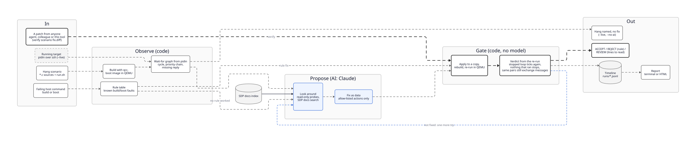

# qnx-doctor

**A gate for fixes to hung QNX 8.0 programs, whoever wrote them.** A coding agent, a colleague or qnx-doctor itself
proposes a patch for a program that stopped making progress because of message passing. `qnx-doctor verify` builds
the program with and without the patch, boots each in QEMU, and answers `accept` only when the stopped loop runs again,
nothing that ran stops, and the same processes still exchange messages. A patch that merely gets the loop ticking
again by cutting a peer out, removing a thread or faking the log is rejected; a patch the rerun cannot vouch for is
sent to a person (`review`), with the lines to read. No model is called.

```sh
python3 -m qnx_doctor.cli verify path/to/scenario fix.diff      # ACCEPT / REJECT (rule) / REVIEW (lines to read)
```

One recorded case, with files that are in this repository (program `bkr`, patch `bkr__2`). On a cache miss the
database server asks the dashboard who owns a key, and that query is part of a deadlock. The patch stops asking and
answers with a made-up owner. All three loops tick again, so a "does it run again" check passes it
(`"liveness_only": true`). The gate does not (the first output line is wrapped here):

```text
$ python3 -m qnx_doctor.cli verify bench/sealed_v6_1123/pool/bkr bench/sealed_v7_1123/patches/bkr__2.diff
REJECT: alive again but the message structure changed: pair no longer exchanges messages:
  /var/qd/bkr/dbd bkrdb bkrhmi -> /var/qd/bkr/hmi bkrhmi bkrgw (after the fix: 0 completed sends, 0 received; need 2 each)
{"id": "bkr", "patch": "bkr__2.diff", "verdict": "reject", "liveness_only": true, "structure_rule": false}
```

In the recorded run `bkr__1`, which answers the same query from a second thread, was accepted.

What we measured, once, on 55 patches written by a fresh agent that saw only the 14 programs, the test harness and a
brief, and labelled by two readers
(53 agree): **the gate rejected 4 of 17 genuine fixes**, three because a request moved to another thread and one
that throttled a CPU load. **It accepted 5 of 30 bad patches where a "does it run again" check accepted 19**, and
**none of the 5 forgeries**. It cannot see what a reply means: an error returned as a reply, an early acknowledgement,
an ignored pulse or a timeout that keeps a loop ticking can pass. Details:
[bench/sealed_v7_1123/RESULT.md](bench/sealed_v7_1123/RESULT.md).

The same engine also diagnoses hangs (`hang`): it reads `pidin` on the target and builds the wait-for graph in code,
and an AI proposes a fix that the gate then judges. On sealed set v6 the model alone diagnosed and fixed as well or
better (22 of 30 causes against 26 and 25, 11 of 18 fixes against 12 and 14), qnx-doctor raised 3 false alarms on 7
healthy programs, and no arm reported a fix the rerun did not prove:
[bench/sealed_v6_1123/RESULT.md](bench/sealed_v6_1123/RESULT.md). For judges: [JUDGES.md](JUDGES.md).

## At a glance



Code observes the problem: it builds the wait-for graph from `pidin`, or checks a failing host command against a rule table. The AI (Claude) only looks around with allow-listed, sandboxed read-only commands and the SDP docs, then proposes a fix as data. Code applies that fix to a copy and re-runs, and the verdict comes from the re-run alone.

Diagram source: `docs/diagrams/flow.d2` (rendered with `d2 --layout elk`). Recorded example timelines: `docs/demo_hang_timeline.html`, `docs/demo_timeline_I04.html`.

## Why this matters on QNX

On QNX, drivers, file systems and your own services are servers that talk through synchronous messages. One wrong
wait (two processes sending to each other, a server that never replies, a high-priority client stuck behind a
low-priority server) stops a whole chain of processes without a crash. QNX's own guide says "Never have two threads
send to each other"; real systems still hit it:

- Mars Pathfinder (VxWorks, 1997): repeated resets; "The failure turned out to be a case of priority inversion",
  fixed by turning on priority inheritance (Glenn Reeves, JPL).
- QNX 6.2.1 (forum, 2005): "pidin -p shows that both threads are blocked by io-net process, and we can't kill or do
  anything to the process."
- QNX Neutrino (forum, 2003): "all the threads that are REPLY-blocked on devc-pty remain blocked forever"; the cause
  was in the application.
- QNX Momentics 6.4.0 release notes, fs-qnx4.so: "A deadlock no longer occurs during one of our benchmark tests."

Who has it: teams building on QNX in vehicles (QNX reports "more than 275 million vehicles") and in medical
devices ("ventilators and infusion pumps" to "robotic surgery"), and anyone moving a control loop onto QNX. Sources,
links and what we did not find: [docs/why_this_matters.md](docs/why_this_matters.md).

## What it does

Two doctors share one engine:

- **Blocked-chain doctor** (`hang`): a QNX program stops making progress. qnx-doctor boots the image in QEMU, takes a `pidin` snapshot on the target, and builds the wait-for graph in code. SEND/REPLY edges point at the peer process. From that graph it finds cycles (deadlock), the processes waiting behind them, and priority chains: a high-priority client waits on a READY low-priority server while a middle-priority thread is runnable (RUNNING or READY). The AI then reads the graph, the source and the QNX docs that ship with the SDP. It returns `edit_file` actions. Code applies them to a copy, rebuilds with `qcc` and runs the image again. The hang counts as fixed only if the re-run shows no cycle or chain, a loop that had stopped prints TICK lines again, no loop that was running stops, and **the program keeps the same message structure**: the fix edits only the program's C sources (not `run.sh`, not the harness), the same processes run (matched by command line, not pid), every pair of processes that tried to send before (a process sending to itself included) still completes sends and the receiver is seen getting them, both still growing between two readings in the rerun (a pulse instead of a synchronous send is fine; no send, a send that stops after a few rounds, or a pulse nobody reads is not), no thread is removed, and a process that takes no part in messaging (a CPU load) keeps its priorities and its load. Message pairs come from `common/qd_trace.c`, which the harness links into every scenario program with `-Wl,--wrap` for each `MsgSend*`, `MsgSendPulse*` and `MsgReceive*` call, so the source does not have to cooperate. The recorder runs in the guest next to the program it records, so it is not tamper-proof (see [Limits](#limits-of-the-check-and-of-the-boundary)). A "fix" that rewires `run.sh`, makes one peer stop sending, removes the load's threads or lowers its priority comes back alive but is rejected as a shortcut.
- **Build/boot doctor** (`run`, `diagnose`, `bench`): a host command fails (SDP not sourced, wrong target, broken `mkqnximage` call, and so on). A rule table runs first. Then the AI looks around with read-only commands and searches the docs. It returns a fix as data, and the command is re-run on a copy, inside the sandbox described below.

What the AI can make the host do (corrected 2026-11-22; until then this README said "the AI never runs a command that
changes the system", which was not true: a probe such as `find . -exec` ran any command, and an `#include` in a
proposed edit could read other files):

- It can ask for a look-around command from a fixed list. Code picks the program by absolute path, checks every option
  against a list per command and every path by its real location (hang mode: the working copy; build/boot doctor: also
  the SDP and QEMU), and runs it in a sandbox.
- It can propose data actions (see `qnx_doctor/actions.py`). In hang mode only `edit_file`, on the program's existing
  C sources. A text check rejects includes from outside, but the barrier is the sandbox around the compiler, the image
  step and QEMU (`qnx_doctor/sandbox.py`: Landlock, seccomp, an environment without secrets). A failed build gives the
  AI file and line numbers only, never the compiler's words.
- In the build/boot doctor a proposed fix changes the command that is re-run, so it can execute code of its own. That
  re-run is sandboxed too; see the limits below.

### Limits of the check and of the boundary

- It does not know what a reply means. On the v7 patch set it accepted a server that answers ENOSYS, a store that
  acknowledges before it commits, collectors whose pulses the receiver passes over, and timeouts that keep a ring
  ticking while most frames are lost. The `review` rule catches only a used reply that disappears or a request turned
  into a pulse that the receiver explicitly drops.
- It is strict about who talks to whom: moving a request to another thread of the same process can read as a pair that
  stopped exchanging messages (3 genuine v7 fixes rejected), and idling a CPU load is never a fix (1 rejected).
- The rerun proves what was observed in that boot: loops ticking, and the same pairs still exchanging messages. It
  does not prove that the program is correct.
- A pulse that the receiver takes and ignores counts as a message exchange. On v6 every arm made one fix that answers
  with an invented value instead of asking, and the check accepted it (bkr in RESULT.md).
- The check is not tamper-proof. Programs in the guest run as root next to the observer, and on a dev target a fix
  written to forge its own message record did pass. For v6, every edit counted as fixed is read in full.
- A priority change in a process that takes part in messaging is not compared, so raising a starved server's priority
  instead of fixing its channel can pass. v6 accepts that as a fix and also reports those fixes as a separate count.
- A hang with a thread waiting on a mutex is never reported fixed: lock use is not recorded.
- qcc needs its licence directory and `/tmp`. There the compiler's children are watched (strace), not blocked: a build
  that opens something else there fails and its output is dropped.
- The sandbox does not block stat() of other paths, chmod of the user's own files or signals to the user's own
  processes. That matters for the build/boot doctor's re-runs. Anything inside the directory given to `qnx-doctor run`
  can be shown to the model: do not start it in a directory that holds secrets.

## Requirements

| | |
|---|---|
| QNX version | QNX SDP 8.0 (`qnx800`), installed on a Linux host |
| Target | x86_64 QNX 8.0 guest in QEMU, built with `mkqnximage --type=qemu --arch=x86_64` (no hardware needed) |
| Toolchain | `qcc -Vgcc_ntox86_64` from the SDP; `mkqnximage` from the SDP |
| Host | Linux x86_64 with Landlock ABI 3 or later (kernel 6.2+) and `/usr/bin/strace`; without them builds, boots and probes refuse to run (`--pidin` and the unit tests still work). Tested on Ubuntu 24.04. Python 3.10+, also as `/usr/bin/python3`; `qemu-system-x86_64` (KVM is used when `/dev/kvm` is writable) |
| AI | `pip install anthropic`, plus `ANTHROPIC_API_KEY` in the environment (no child process gets it). Model: `QD_MODEL`, default `claude-opus-5-5`. Not needed with `--no-ai` |

Environment: `QNX_SDP` (default `~/personal/qnx/qnx800`) and `QD_QEMU_ROOT` (a QEMU install root; default `~/personal/qemu_local/root`).
The defaults are the paths of our own server, so set both on any other machine.

Installing the SDP on a server with no desktop and booting the QEMU target, step by step, with the errors we hit:
[docs/tutorial/headless-sdp8-qemu.md](docs/tutorial/headless-sdp8-qemu.md).

## Build and run

```sh
git clone https://github.com/dormkim/qnx-doctor.git && cd qnx-doctor

# Gate: judge a patch (unified diff against the scenario directory, or JSON edit_file actions).
# This program and patch are in the repository; the recorded verdict is REJECT (exit status 1).
python3 -m qnx_doctor.cli verify bench/sealed_v6_1123/pool/bkr bench/sealed_v7_1123/patches/bkr__2.diff --out verify.jsonl

python3 -m qnx_doctor.cli index                       # once: index the QNX docs installed with the SDP

# Hang on a running target, no harness: three pidin snapshots + pidin arg over ssh → wait graph (read-only)
python3 -m qnx_doctor.cli hang --live "ssh root@<target>" --src path/to/your/sources

# Hang: read-only analysis of a pidin capture (no SDP needed)
python3 -m qnx_doctor.cli hang --pidin tests/unit/fixtures/pidin_dl2_1115.txt

# Hang: full loop on a scenario: build with qcc → image → boot in QEMU → graph → AI fix → rebuild → re-run
python3 -m qnx_doctor.cli hang --scenario scenarios/hang_demo/control_loop --out runs/demo.jsonl
python3 -m qnx_doctor.cli hang control --scenario scenarios/hang_demo/control_loop --no-ai   # name the hang only, focused on "control"
python3 -m qnx_doctor.report runs/demo.jsonl --id control_loop --html demo.html            # timeline for people

# Build/boot doctor on any failing command (fixes are tried on a copy of the current directory)
python3 -m qnx_doctor.cli run -- make -C myproject
```

**Attach to a running target** (`--live`, design and limits in [docs/live_attach_1116.md](docs/live_attach_1116.md)): no
`run.sh`, TICK logs, `--wrap` recorder or observer program. It names the cycle, chain or missing reply and each
process's command line, and points at message-passing calls in your sources. It does not fix or rerun; that needs
the test loop below. It reads only threads whose Blocked column is a pid or empty, so a server with a worker waiting
on a mutex can be named a missing reply here (the test loop reads every thread). Tried once so far, on our demo program built with plain `qcc` and started by the image at boot
(`bench/live_demo.sh`); the ssh path is not tested yet.

A hang scenario (the test loop) is a directory with `*.c` sources and a `run.sh` that starts the processes. On the target, `check.sh` first starts the observer `snap` (so it is already loaded), then runs `run.sh`. When `run.sh` returns, it wakes `snap` with the shell builtin `kill`. At priority 63, `snap` counts the TICK lines in each `/tmp/d0<role>.log` and prints a `pidin` snapshot. The observer must be loaded before the scenario starts: `/var` and `/tmp` are on the disk image, and in our scenarios the CPU load runs above the disk driver's priority, so an observer loaded later could only look after the hang had cleared. A sibling `common/` directory holds `qd.h`, `snap.c`, `hi.c` and `check.sh`. See `scenarios/hang_demo/`.

Harness rules for steady verdicts (2026-11-17): `check.sh` runs under `hi` at priority 50, but every scenario program starts at the normal priority 10 (`common/qd_start.c`, linked in like `qd_trace.c`), so a busy program cannot starve the serial or disk driver. `snap` writes nothing to the console while it looks: `pidin` goes to `/dev/shmem` first, and two more snapshots follow a moment later. A priority chain or a missing reply counts only if the same waiter → server pair is in all three. Only one QEMU guest runs at a time on a host (`bin/qd-target-exec` takes a lock).

## What we measured, and what got worse

### Patch set v7 (2026-11-23): the gate

Plan and wording rules committed before any code ([bench/V7_VERIFY_PLAN.md](bench/V7_VERIFY_PLAN.md)); patches by a
fresh agent on the 14 v6 hang programs without a mutex wait; labels by that author and a second fresh reader; sealed
(`v7-seal`) and run once. The first run failed in our patch loader before any patched boot and was repeated after a
loader-only fix (`v7.1-freeze`); both runs are kept.

| checker | bad patches accepted | forgeries accepted | genuine fixes not accepted |
|---|---|---|---|
| "the stopped loop ticks again" only | 19 of 30 | 4 of 5 | 0 of 17 |
| structure rules (v6 gate) | 6 of 30 | 0 of 5 | 4 of 17 |
| v7 gate (+ review rule) | 5 of 30 | 0 of 5 | 4 of 17 |

Every wrong verdict is listed with its reason in [RESULT.md](bench/sealed_v7_1123/RESULT.md).

### Sealed set v6 (2026-11-23): the number that counts

Written by a new author who had not seen the code, sealed (`v6-seal`), 30 of 30 reproduced without the tool, run once
with four arms on the same model. Criteria and wording were fixed before the seal ([bench/V6_PLAN.md](bench/V6_PLAN.md)).

| arm | kind found | false alarm on healthy | unknown labels hit | fixed (first try / with retries) | genuine after reading | false fix |
|---|---|---|---|---|---|---|
| code (no AI) | 22/30 | 3/7 | 5/5 | - | - | 0 |
| qnx-doctor | 22/30 | 3/7 | 5/5 | 11 / 11 of 18 | 10 | 0 |
| naive (same model, one answer) | 26/30 | 0/7 | 5/5 | 12 / 12 of 18 | 9 (+2 priority only) | 0 |
| naive_x2 (same retry as ours) | 25/30 | 0/7 | 5/5 | 12 / 14 of 18 | 11 (+1 priority only) | 0 |

What got worse, and is published as found: the false alarms (two healthy programs next to a CPU load, one timer-driven
server whose loops kept ticking), the self-send deadlock it does not name, two pool-exhaustion deadlocks it found but did
not fix, and a masking fix the rerun check accepted in every arm (a pulse that is received and ignored counts as a
message exchange). Every fix counted as fixed was read in full: [RESULT.md](bench/sealed_v6_1123/RESULT.md).

### Sealed set v3 (2026-11-17): the first set we did not write, now a development set

Note of 2026-11-22: the "fixed" counts below and in v4 and v5 come from a verifier that read the message records
once. On dev targets that verifier also accepted fixes whose messages stopped after a few rounds
([what was found and repaired](bench/V6_GATES_1122.md)). The records cannot show whether a recorded fix had that
shape at run time, so read those counts as "passed the verifier of that day".

How the set was made, before any number:
- An agent that had not read qnx-doctor's source, prompts, verifier or past results wrote 21 QNX 8.0 scenarios and
  their answer key (`bench/sealed_v3_1117/README.md` lists exactly what it read). Names, comments and log lines are
  written as a developer would write them, and some mislead on purpose.
- The answer key and the scenario tree were hashed and committed before any run (`bench/sealed_v3_1117/SEAL.md`,
  commit d9d562b). The scoring rules were committed next (caecd37), then a reproducibility check of the unmodified
  scenarios (b075721). Then one run with four arms. Nothing was tuned on this set.
- 5 of 21 were excluded before scoring, with their reasons; no label was edited (`bench/sealed_v3_1117/excluded.json`).
  Four (q02, q06, q09, q21) because our second observer never returned a second TICK count: it reads logs from the
  disk, and these scenarios load the CPUs above the disk driver. Those four are all of the priority-chain cases, so
  **this set says nothing about priority chains**. One (q16) because a loop that should keep running printed nothing;
  most likely our own harness bug, described below.
- Arms, all with the same model: **ours** (code names the kind from the wait graph; the AI fixes, up to 2 tries);
  **naive** (source and TICK logs only, no `pidin`, no graph, no docs, 1 try); **naive_x2** (naive plus one retry,
  told the rerun's TICK counts and verdict). Every arm's fix goes through the same rerun check.
- Small numbers: 16 scenarios scored, of which 8 are fixable faults, 4 are healthy, 4 are "unknown" (the loop stops,
  but not because of a send cycle, a priority chain or a missing reply).
- "Unknown" for ours: qnx-doctor has no literal "unknown" output yet. It prints "loop not running but no wait cycle
  or chain found" and then does not call the AI; the scoring rule committed before the run reads that as "cannot tell".

| arm | kind found | deadlock | missing reply | healthy left alone | unknown said "cannot tell" | false alarm on healthy | fixed (rerun-proven) | "fixed" on an unknown case | false fix |
|---|---|---|---|---|---|---|---|---|---|
| ours | 13/16 | 4/5 | 3/3 | 3/4 | 3/4 | 1/4 | 3/8 | 0 | 0 |
| naive | 12/16 | 5/5 | 3/3 | 4/4 | 0/4 | 0/4 | 2/8 | 2 | 0 |
| naive_x2 | 11/16 | 4/5 | 3/3 | 4/4 | 0/4 | 0/4 | 3/8 | 3 | 0 |

Source: `results/sealed3_20261117/score.md` (copied from the run; per-axis table and literal outputs are there).

What held:
- On the 4 unknown cases the baselines named a hang kind every time. On the two whose cause is outside the given
  sources (q12: a server waits for a signal from a supervisor that is not in the scenario; q17: it waits for a
  semaphore an external calibration tool should post), both baselines deleted the wait or posted the semaphore
  themselves, and the rerun check accepted it because the loop ran again. ours made no fix on any unknown case.
- False fixes on healthy programs: 0 in every arm.

What got worse, or did not get better:
- **Fix rate is a tie** with the same-retry baseline: 3/8 and 3/8, the same three scenarios. On this set the wait
  graph and the docs added no fixes over a second try.
- **One false alarm on a healthy program** (q19), baselines 0. A server holds each reply until a periodic pulse, so
  every snapshot shows the client REPLY-blocked on a server waiting in RECEIVE: the picture of a missing reply. The
  client was still printing TICKs. Our judge looks at thread states, not at whether the TICK count grows.
- **One missed deadlock** (q10), naive 5/5. The most likely cause is our harness: the recorder we link into every
  scenario (`common/qd_trace.c`) made its own kernel calls between the program's `TimerTimeout()` and its
  `MsgReceive`, so the timeout was used up, the program never reached the deadlock, and the snapshot showed no cycle.
  The baselines named the deadlock from the source. The same bug can affect q13 and q16 (the other two scenarios
  that use `TimerTimeout`). A fix is now on `main` (merged from `fix/trace-timertimeout`); it was checked on a new
  harness test, not on this set.
- **One unknown case called healthy** (q11, a CPU spin): the loop had printed TICKs before it stopped, and the code
  treats "some TICKs" as running.

We do not rerun v3 with any of these fixes. They were to be measured on a new sealed set (v4), written by a new author,
sealed before the run and run once. Analysis: [docs/analysis_sealed3_1117.md](docs/analysis_sealed3_1117.md).

### After v3: sealed sets v4 and v5 (run 2026-11-18), now development sets

The fixes for the v3 failures are on `main`, checked only on new harness tests (`tests/harness_checks/`) and unit
tests, never on v3:
- the recorder re-arms the program's `TimerTimeout` right before the real call (q10, q16);
- the observer counts TICKs twice in the same boot, and the reproducibility check uses those two counts instead of a
  second observer that hung under a CPU load above the disk driver (the 4 excluded chain scenarios); `/tmp` is in RAM;
- the judge checks progress: a waiter whose loop keeps ticking is not hung, and "healthy" needs the count to grow
  (q19 false alarm, q11 called healthy);
- the tool says `unknown` itself (spinning on the CPU, blocked outside message passing, or not enough information)
  and still calls no AI and claims no fix in that case.

None of this is a v3 result. v4 was written by a new author who had not seen the code, sealed and run once on
2026-11-18 ([plan](bench/V4_PLAN.md), [result](bench/sealed_v4_1117/RESULT_1118.md)); v5, written by the main session
after a harness fix, was run once the same day ([result](bench/sealed_v5_1118/RESULT_1118.md)). Both have been opened
and read case by case since, so (corrected 2026-11-21) **v3, v4 and v5 are now used as development sets**: changes
are tried on their records ([bench/DEVSET_RECALC_1121.md](bench/DEVSET_RECALC_1121.md)) and none of those numbers
is a claim. The number that counts is sealed set v6, above.

### Earlier sets (shaped by people who knew the code)

These came first and were written by the same people who wrote qnx-doctor: the generators, the verifier, the
baseline prompt and the scorer. The verifier rule was changed once after looking at v1 results. Read them as
development numbers.

- `tests/sealed_hang/`: 7 hand-written scenarios, sealed before the judge existed (file names hint at the bug).
- `tests/gen_hang/` v1 (20 held-out seeds) and v2 (30 held-out seeds, `sealed2.json`): seeded random generators with
  decoys, run-time wiring and priorities. On v2 every arm named all 30 kinds. Fixed on the first try: ours 24/25,
  naive 20/25 (ours could also retry, 25/25; the naive arm had one try, so "25 vs 20" mixes two effects). Records:
  [docs/measure_structure_1116.md](docs/measure_structure_1116.md), [docs/measure_holdout_1116.md](docs/measure_holdout_1116.md).
- None of these sets use `TimerTimeout`, so the recorder bug above does not touch them.

Scoring code: `bench/score_hang.py`, `bench/score_structure.py` (the only code that reads answer keys).
`bench/fake_fix_check.py` attacks the verifier with shortcut fixes on dev scenarios. Only states are reported
(blocked or running, TICK or no TICK); no QNX timing or performance numbers are published (QNX licence 4.6(i)).

Unit tests (no SDP needed): `python3 -m unittest discover tests/unit`. Tests that need the `anthropic` package are
skipped when it is not installed.

## How qnx-doctor uses QNX (API map)

| QNX API or tool | Where | What it is used for |
|---|---|---|
| `pidin` (thread state, `Blocked` column, priority) | `common/snap.c`, `qnx_doctor/waitgraph.py` | The wait-for graph: SEND/REPLY edges to the peer process, cycles (deadlock), priority chains (READY low-priority server, runnable middle thread), missing replies (REPLY-blocked on a process whose threads all wait in RECEIVE) |
| `pidin arg` | `common/snap.c`, `qnx_doctor/structure.py` | Match processes across two boots by command line, not by pid |
| `MsgSend*`, `MsgSendPulse*`, `MsgReceive*`, `MsgDeliverEvent`, `MsgRegisterEvent` with `-Wl,--wrap` | `common/qd_trace.c` | Message-structure recorder. A fix must keep every pair that talked before. An event pair is recorded at both ends: the server names the client from the rcvid, the client names the server from the event it registered and counts its pulses |
| `MsgInfo`, `ConnectClientInfo`, `ConnectServerInfo` | `common/qd_trace.c` | Name the peer process of each message, pulse and event |
| `/dev/shmem` (RAM files served by `procnto`) | `common/qd_trace.c`, `common/snap.c` | Records and snapshots that need no disk driver while a CPU load runs |
| `pthread_setschedprio`, priorities 63 / 50 / 10 | `common/snap.c`, `common/hi.c`, `common/qd_start.c` | Observer above the scenario; scenario programs at the normal priority |
| `ChannelCreate(_NTO_CHF_FIXED_PRIORITY)` vs priority inheritance | scenarios, AI prompt | The cause of a priority chain, and its QNX fix (let the server inherit the client's priority) |
| `MsgSendPulse`, `MsgRegisterEvent` + `MsgDeliverEvent` | scenarios, AI prompt, `bench/stability_check.py` | Non-blocking notification: the QNX fix for a server that sends back to a client that is waiting for its reply |
| `MsgReply` / `MsgError` | scenarios, `waitgraph.missing_replies` | A server path that never replies leaves its client REPLY-blocked |
| `name_attach`, `name_open`, `ConnectAttach(_NTO_SIDE_CHANNEL)` | `common/qd.h`, scenarios | Named channels; side-channel connection ids |
| `qcc -Vgcc_ntox86_64`, `mkqnximage --type=qemu` | `qnx_doctor/hang.py` | Build each scenario and a bootable image |
| SDP documentation (`com.qnx.doc.*`) | `qnx_doctor/docs.py` | `search_docs` for the AI; doc paths are cited in the diagnosis |

## Layout

```
qnx_doctor/  verify.py (the gate: build, boot and judge a patch, no model)  gate.py (accept / reject / review rules)
             waitgraph.py (pidin → graph → verdict, pure)  structure.py (same message structure, pure)  hang.py / hangdoctor.py (target loop)
             live.py (running target, no harness: pidin over a transport → graph)
             ai.py (look-around loop)  probes.py (look-around allow-list)  actions.py (fix allow-list)
             sandbox.py (kernel boundary)  source_check.py (text check of edits)  docs.py (SDP docs index)  report.py (timeline)
             doctor.py / rules.py / runner.py (build/boot doctor)  cli.py
bin/         qd-target-exec (boot image in QEMU, run one command, return its status)  qd-boot
tests/       unit/  sealed_hang/  gen_hang/  sealed/ (build/boot set)
bench/       scorers, baseline arms, plans and freezes
             sealed_v7_1123/ (the patch set for the gate: patches, two label files, SEAL.md, run_1123b/)
             sealed_v6_1123/ (the scenario set for diagnosis: pool, answer key, SEAL.md, run_1123/)
             sealed_v3_1117/, sealed_v4_1117/, sealed_v5_1118/ (earlier sealed sets, now development sets)
results/     the recorded v3 run, which can be re-scored (sealed3_20261117/)
scenarios/   hang_demo/control_loop (sensor → control → actuator)
```

Licence: Apache-2.0.
